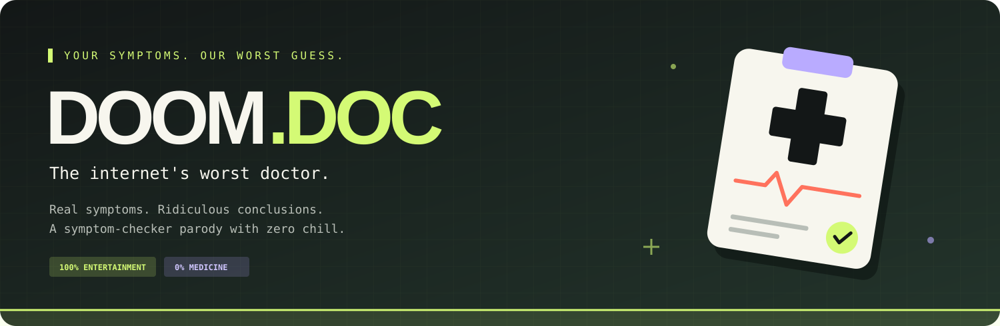

<p align="center">
  
</p>

<p align="center">
  <a href="https://albertinothecoder.github.io/Doom-Doc/"></a>
  <a href="https://github.com/AlbertinoTheCoder/Doom-Doc/actions/workflows/check.yml"></a>
  
  
</p>

<p align="center">
  Select your symptoms. Receive an absurd diagnosis. Share your doom.<br />
  <strong>Entertainment only. Fictional diagnoses. Not medical advice.</strong>
</p>

## The experience

- Search and filter symptoms, or let the random picker decide your fate.
- Generate a wildly fake diagnosis with equally questionable treatment.
- Reroll your results and copy them to share.
- Use it on mobile or desktop, with no account or installation.

## Try it

**[Open DOOM.DOC →](https://albertinothecoder.github.io/Doom-Doc/)**

To run locally, open `index.html` in your browser. No build step or API keys required.

Prefer a local server? Run `python -m http.server 8000` and visit <http://localhost:8000>. Clipboard access works best on localhost or HTTPS.

## Development

The complete app lives in `index.html`: markup, styles, symptom data, and logic.

```sh
npm ci
npm run format
npm run check
```

Node.js is only needed for formatting. GitHub Actions checks formatting on pushes and pull requests to `main`. GitHub Pages publishes the site from `main` automatically.

## Contributing

Keep changes focused, preserve the satire disclaimer, and run `npm run check`. For UI changes, check mobile and desktop layouts and include a screenshot in your pull request.
